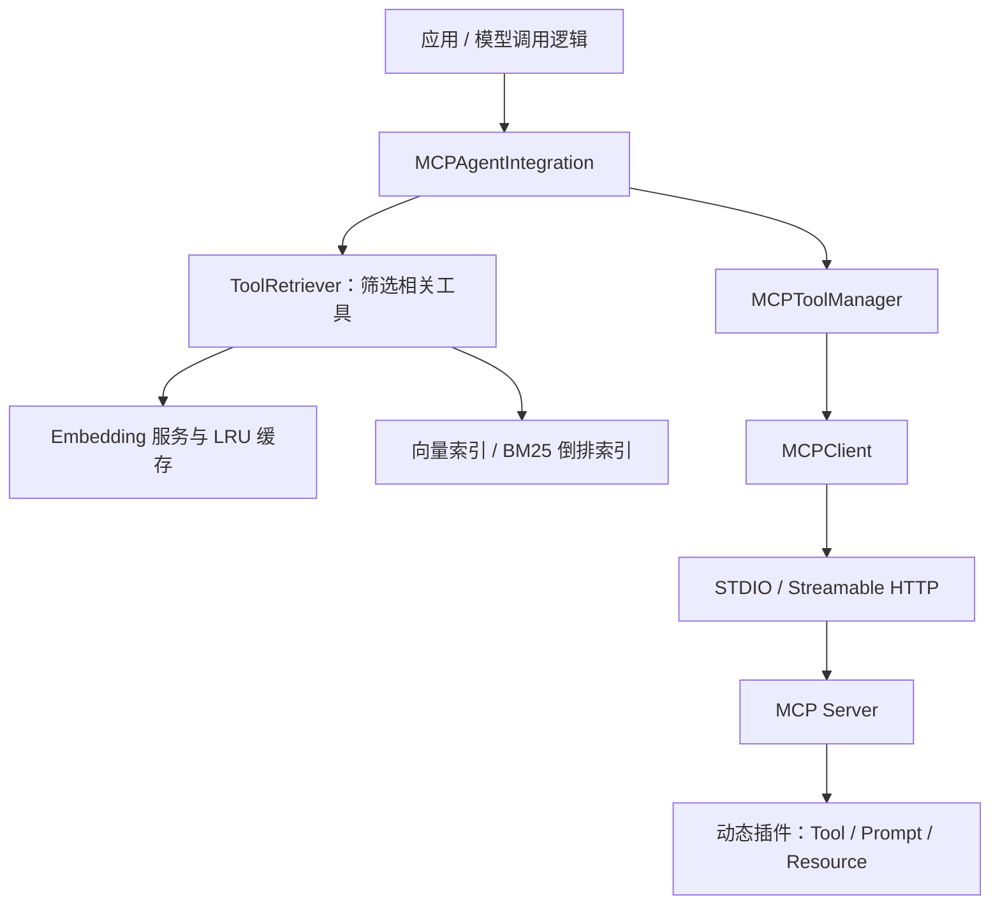

# MCP Agent Runtime

一个使用 **C++20** 实现的 MCP 客户端、插件式服务端与 RAG 工具检索项目。

项目围绕“发现工具 → 筛选工具 → 执行调用”构建：通过 MCP 获取工具定义，按用户问题检索相关工具，再将候选交给模型选择并执行。适合学习 C++ 下的 MCP 通信、动态插件扩展，以及工具数量增加时的检索与评测。

## 核心能力

| 模块 | 已实现的能力 |
| --- | --- |
| MCP 客户端 | STDIO 与 Streamable HTTP 两种传输；Tool、Prompt、Resource 接口；通知回调 |
| 请求管理 | 请求 ID 匹配、超时等待、取消通知、断开连接时唤醒等待请求 |
| 插件式服务端 | 启动时递归加载 `.so` 插件，统一分发工具调用、提示模板和资源读取 |
| Agent 集成层 | 工具发现与缓存、同步/异步调用、调用结果封装、RAG 候选筛选 |
| RAG 工具检索 | 向量相似度检索、BM25 + RRF 混合检索、MMR 多样性选择 |
| 缓存与索引 | 带 TTL 的 LRU Embedding 缓存、向量索引保存与加载 |
| 验证与评测 | 离线回归、真实模型端到端测试、全量工具与 RAG 候选的对照评测 |

这里的 RAG 检索对象是**工具名称、描述和参数元数据**。检索结果用于缩小模型看到的工具集合。

## 整体结构



`MCPClient` 负责通信，`MCPToolManager` 管理工具元数据与调用，`MCPAgentIntegration` 提供应用侧接口。当前集成层通过 STDIO 启动本地服务；使用 Streamable HTTP 时直接配置 `MCPClient`。

模型请求和工具结果回传由上层应用组织，仓库中的在线端到端程序提供了完整示例。

## 快速开始

以下命令在项目根目录执行，面向 **Linux / WSL**。当前代码使用 POSIX 进程、管道和 `dlopen`，插件加载器识别 `.so` 文件；Windows 下请使用 WSL。

### 1. 安装依赖

需要支持 C++20 的编译器、CMake 3.20+、pkg-config、libcurl、jsoncpp，以及 nlohmann-json 开发包。Ubuntu / Debian 可执行：

```bash
sudo apt-get install -y \
  build-essential cmake pkg-config \
  libcurl4-openssl-dev libjsoncpp-dev nlohmann-json3-dev
```

### 2. 获取并构建

```bash
git clone https://github.com/naplatte/mcp-agent-runtime.git
cd mcp-agent-runtime

cmake -S . -B build -DCMAKE_BUILD_TYPE=Release \
  -DBUILD_TESTS=ON -DBUILD_MCP_EXAMPLES=ON
cmake --build build -j4
```

`BUILD_TESTS` 和 `BUILD_MCP_EXAMPLES` 默认开启，可按需关闭。主要产物：

| 路径 | 用途 |
| --- | --- |
| `build/mcp_server/mcp_server` | MCP 服务端 |
| `build/mcp_server/plugins/` | 各插件子目录中的共享库 |
| `build/mcp_client/libmcp_client.a` | 客户端静态库 |
| `build/examples/rag_mcp_example` | 集成层与工具检索示例 |
| `build/tests/cpp/` | C++ 回归与集成测试程序 |

### 3. 运行离线回归

```bash
ctest --test-dir build --output-on-failure
```

CTest 注册了 `mcp_timeouts`、`rag_mmr` 和 `rag_hybrid` 三组测试，覆盖传输与请求生命周期、MMR、关键词索引和混合检索。它们不需要模型密钥或真实天气接口。

### 4. 体验工具调用

```bash
./build/tests/cpp/test_mcp_integration \
  ./build/mcp_server/mcp_server \
  ./build/mcp_server/plugins \
  --interactive
```

客户端会启动 STDIO 服务并发现插件，按终端提示列出或调用工具。计算器工具可在本地运行；天气工具需要访问外部接口。

## 使用 Streamable HTTP

在第一个终端启动服务：

```bash
mkdir -p build/logs
./build/mcp_server/mcp_server \
  --streamable-http --http-port 8080 \
  -p ./build/mcp_server/plugins \
  -l ./build/logs
```

在第二个终端运行客户端：

```bash
./build/tests/cpp/test_mcp_integration \
  ./build/mcp_server/mcp_server \
  ./build/mcp_server/plugins \
  --streamable-http http://127.0.0.1:8080/mcp \
  --interactive
```

服务默认绑定 `127.0.0.1`，MCP 入口为 `/mcp`，健康检查为 `/health`。可通过 `--request-timeout-ms` 设置 HTTP 响应超时，通过 `--sse-keepalive-ms` 设置 SSE 保活间隔；完整参数见 `mcp_server --help`。

## 在 C++ 应用中接入

下面的最小示例使用 STDIO 连接服务并执行计算器工具，无需模型服务。运行目录为项目根目录。

```cpp
#include "agent_rpc/mcp/mcp_agent_integration.h"
#include <iostream>

int main() {
    using namespace agent_rpc::mcp;

    MCPAgentConfig config;
    config.enable_mcp = true;
    config.mcp_server_path = "./build/mcp_server/mcp_server";
    config.mcp_args = {"-p", "./build/mcp_server/plugins"};

    MCPAgentIntegration integration;
    if (!integration.initialize(config) || !integration.isAvailable()) {
        std::cerr << "MCP connection unavailable\n";
        return 1;
    }

    const auto result = integration.callTool(
        "calculator", R"({"expression":"123 + 456"})");
    std::cout << (result.success ? result.result : result.error) << '\n';

    integration.shutdown();
    return result.success ? 0 : 1;
}
```

在本项目的 CMake 构建中，将应用链接到 `mcp_client` 目标即可。`initialize()` 允许连接失败时降级返回，因此调用工具前需要检查 `isAvailable()`。

## 启用 RAG 工具筛选

在初始化前，为上述 `config` 添加配置：

```cpp
config.rag_config.enabled = true;
config.rag_config.top_k = 5;
config.rag_config.enable_hybrid = true;  // 可选：向量 + BM25 + RRF
config.rag_config.index_path = "./build/tool_index.json";
```

在运行环境中设置 `DASHSCOPE_API_KEY`，默认 Embedding 模型为 `text-embedding-v2`。初始化后，使用以下接口获取候选：

```cpp
if (!integration.isRAGEnabled()) {
    // 按应用需要处理 RAG 未就绪的情况。
}
auto tools = integration.getRelevantTools("计算 123 加 456");
auto functions = MCPAgentIntegration::toFunctionCallingFormat(tools);
```

`functions` 是包含 `name`、`description`、`parameters` 的函数定义数组；对接 Chat Completions 的 `tools` 字段时，需要为每项包装 `{"type":"function","function":...}`。模型选择工具后，再调用 `integration.callTool()` 并将结果回传模型。

可用的三种检索方式：

| 方式 | 配置 | 处理过程 |
| --- | --- | --- |
| 向量检索 | 默认；不启用 Hybrid 或 MMR | 工具元数据向量化，按余弦相似度取 Top-K |
| 混合检索 | `enable_hybrid = true` | 向量与本地 BM25 分别召回，再使用 RRF 融合排名 |
| MMR | `enable_mmr = true` | 从向量候选池逐次选择，平衡相关性与候选间的相似度 |

Hybrid 和 MMR 当前不能同时启用。混合检索不增加额外的查询 Embedding 请求，但仍依赖有效的向量索引与查询向量。

RAG 默认关闭。未启用或初始化失败时，`getRelevantTools()` 返回全量工具；已启用后的检索失败可能返回空列表，应用需要检查 `isRAGEnabled()` 和候选结果。

## 内置插件

| 插件目录 | 类型 | 提供的能力 |
| --- | --- | --- |
| `calculator` | Tool | 表达式计算、加减乘除、幂、平方根、阶乘 |
| `weather` | Tool | `get_weather`：按城市及经纬度查询天气 |
| `sleep` | Tool | `sleep`：延时执行，支持协作取消 |
| `log-analyzer` | Tool | `tail_log`、`analyze_log`、`summarize_errors` |
| `notification` | Tool | `progress_test`、`logging_test`：通知演示 |
| `code-review` | Prompt | 代码审查提示模板 |
| `bacio-quote` | Resource | `bacio:///quote`：名言文本资源 |

服务端启动时递归扫描 `-p` 指定的目录。扩展插件时，可参考 [PluginAPI.h](mcp_server/include/PluginAPI.h)、[calculator 插件](mcp_server/plugins/calculator/Calculator.cpp)及其 [CMake 配置](mcp_server/plugins/calculator/CMakeLists.txt)。插件导出 `CreatePlugin` 和 `DestroyPlugin`，可额外导出 `HandleRequestWithContext` 接收取消上下文。

## 在线验证与效果评测

### 真实模型端到端测试

配置 `DASHSCOPE_API_KEY` 后运行：

```bash
./build/tests/cpp/test_rag_agent_e2e \
  ./build/mcp_server/mcp_server \
  ./build/mcp_server/plugins/calculator
```

程序验证“工具发现 → C++ RAG 筛选 → 模型选择 → MCP 执行 → 结果回传模型”的链路，默认对话模型为 `qwen-plus`。缺少密钥时以退出码 `77` 跳过；详细检查项见 [端到端测试说明](docs/cpp-rag-agent-e2e.md)。

### 工具选择对照

评测脚本需要 Python 3.10+，无需额外 Python 包：

```bash
# 离线自检：验证评测流程，不产生真实模型效果结论
python3 tests/rag_effectiveness/run.py --self-test

# 在线对照：全量工具 vs 混合检索筛选出的工具
python3 tests/rag_effectiveness/run.py \
  --live --selection hybrid --k 20 --repeats 1
```

在线对照使用 80 道题和 50 / 100 / 300 三档工具目录，统计模型的**工具选择命中率**与接口返回的**平均输入 token**。目录包含真实 MCP 工具定义和模拟定义；该评测只检查模型选择，不执行工具业务，也不评判参数正确性。报告默认保存在 `tests/rag_effectiveness/results/`，详细用法和统计口径见 [评测说明](tests/rag_effectiveness/README.md)。

在线测试会调用外部 Embedding / 对话接口。离线回归通过不能证明在线命中率提高，具体收益需要在相同模型、问题和参数下实际对照。

## 目录导航

```text
.
├── common/                    # 公共日志组件
├── mcp_client/
│   ├── include/agent_rpc/mcp/  # 客户端、Agent 集成层与 RAG 接口
│   └── src/                   # 通信、工具管理及检索实现
├── mcp_server/
│   ├── include/               # 服务端、传输与插件 ABI
│   ├── src/                   # 协议分发、传输及插件加载
│   └── plugins/               # 内置 Tool / Prompt / Resource 插件
├── examples/                  # RAG-MCP 使用示例
├── tests/
│   ├── cpp/                   # C++ 回归与集成验证
│   ├── python/                # Python 客户端示例
│   └── rag_effectiveness/     # 工具选择对照评测
├── third_party/               # 随仓库提供的单头文件依赖
└── docs/                      # 检索策略与端到端说明
```

进一步阅读：[混合检索](docs/rag-hybrid.md) · [MMR](docs/rag-mmr.md) · [在线端到端链路](docs/cpp-rag-agent-e2e.md) · [效果评测](tests/rag_effectiveness/README.md)。

## 当前边界

- 项目提供 MCP 通信、插件与工具检索组件；模型接入及多轮任务调度由应用负责。
- 向量索引使用内存中的全量相似度计算与排序，没有接入独立向量数据库或近似最近邻索引。
- 取消采用协作方式：客户端超时会发送取消通知，插件需要主动检查取消状态；旧插件不会因此被强制中断。
- 插件在服务端进程内执行，当前没有进程隔离或运行时热更新。HTTP 服务默认用于本机接入，没有实现完整的身份认证与权限体系。
- 对异步调用，调用方需要保证集成对象存活到回调结束。

## 版权与许可

服务端部分源码保留了 MIT 许可声明（Copyright © 2025 Giuseppe Mastrangelo）。第三方依赖的版权与许可见各文件声明，使用与分发时请一并保留。
